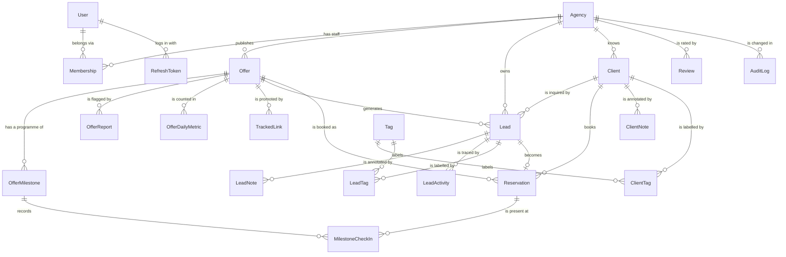

# Data Model Overview

The database is the part hardest to change once real data exists. Code can be rewritten in a
weekend; a wrong table shape follows you for years. So this page is worth understanding before
anything else in the backend.

Source of truth: the `models.py` files under `apps/`. If this page and those files disagree,
the files are right and this page is a bug — tell me.

```bash
# the whole schema, in one command
grep -n "^class \|    [a-z_]* = models\." apps/*/models.py
```

That works because Django has no `schema.prisma` — **the models *are* the schema.** There is no
separate file describing the tables; the Python class is the description, and `makemigrations`
derives the SQL from it. One fewer file to keep in sync, and one fewer place for the
description and the reality to disagree.

---

## What actually exists here

**Twenty-one models across five apps.**



| App | Model | A row is | Note |
|---|---|---|---|
| `accounts` | `User` | one person — traveler, agency staff, or both | [[User]] |
| | `Agency` | **the tenant** | [[Agency]] |
| | `Membership` | one person's role at one agency | [[Multi-Tenancy]] |
| | `RefreshToken` | one live login session, hashed | [[Auth Flow]] |
| | `AuditLog` | one recorded change, append-only | [[Audit Log]] |
| `offers` | `Offer` | one thing for sale | [[Offer]] |
| | `OfferMilestone` | one stop in a trip's programme | [[Trip Programme]] |
| | `OfferReport` | a traveler flagging a listing | [[Duplicate and Spam Control]] |
| | `TrackedLink` | a short code pasted into a Facebook post | [[Tracked Links]] |
| | `OfferDailyMetric` | one offer's counters for one day | [[Offer Analytics]] |
| `leads` | `Lead` | one traveler's inquiry — the CRM's centre | [[Lead]] |
| | `Client` | one person the agency knows, keyed by phone | [[Client]] |
| | `ClientNote` | free text about the person, editable | [[Client]] |
| | `ClientTag` | one label on one client | [[Client]] |
| | `LeadNote` | free text a human wrote, editable | [[Lead]] |
| | `LeadActivity` | the system's timeline, append-only | [[Lead]] |
| | `Tag` | an agency-invented label | [[Client Quality Labels]] |
| | `LeadTag` | one label on one lead | [[Client Quality Labels]] |
| `trips` | `Reservation` | one family actually going on a departure | [[Trip Manifest]] |
| | `MilestoneCheckIn` | one family's attendance at one checkpoint | [[Trip Programme]] |
| `reviews` | `Review` | a rating, tied to a lead that really happened | [[Agency Ratings]] |

Two models are worth pointing at now, because their *pairing* teaches something the others
don't:

**`LeadNote` and `LeadActivity` look like one table split in two, and they aren't.** A note is
a human's working memory — editable, deletable, "she said call back after Aïd". An activity is
the system's record — appended, never edited, `LeadActivity.delete()` literally raises. One
table for both would let staff edit the audit timeline (making it worthless as evidence in a
dispute) *and* drown real notes in system noise. **Editability is the design axis, not
subject matter.**

**`Offer.KINDS` is `choices`; `Tag` is a table.** Both are "a list of allowed labels". The
difference is whose decision it is: *you* control offer kinds, so changing them is a code
change with a migration and a reviewer. *Agencies* invent their own tags, so those must be
rows. Getting this backwards is the most common schema mistake there is, and the question is
never "how many values" — it is **whose decision is it?**

---

## The two halves

Everything divides into **public marketplace** and **private tenant space**:

| | Public side | Private side (per agency) |
|---|---|---|
| Who reads it | anyone, including Google | only that agency's staff |
| Models | `Agency` (verified only), `Offer` (published only), `Review`, `OfferMilestone` | everything else |
| Risk if leaked | none, it's marketing | business-ending — see [[Multi-Tenancy]] |

Every model on the private side carries a non-null `agency` foreign key. **That column is the
entire security model.** Not the handlers, not `require_membership` — those are how it's
applied. The column is what makes applying it possible, and
`test_tenant_models_declare_a_non_null_agency` fails the build if one ever goes nullable.

Note what "public" means precisely: not the *table*, but a *queryset*. `Offer.publicly_visible()`
is `status='published'`, `agency__status='verified'`, and not a confirmed duplicate. The offers
table also contains every agency's unpublished drafts, which are as private as leads are. See
[[The Seven Hops of a Request]].

---

## Why a column is a column

The recurring schema question is: does this deserve a column, or does it belong in a blob?

A column is right when the database needs to **filter, sort, or constrain** on it. Anything in
a search filter, anything with a uniqueness rule, anything a foreign key points at.

A JSON blob is right for attributes that vary by *kind* of row and that nothing queries — an
Omra offer's nights in Makkah, a visa offer's processing days. Giving each of those its own
column produces a table where nine columns out of ten are `NULL` on every row, and a new offer
kind means a migration.

`Offer.attributes` is that blob: `models.JSONField(default=dict, blank=True)` — real `jsonb` on
Postgres, queryable with `filter(attributes__nights_makkah__gte=4)`, text on SQLite.

> [!warning] Honest state — the blob has no rules
> `OfferIn` types it `dict`. Any JSON object is accepted: no per-kind schema, no key
> allowlist. `nightsInMakkah`, `nights_in_makkah` and `nightsInMaccah` are all equally valid,
> and two of them are data nothing will ever read.
>
> The NestJS repo validates it with a strict Zod schema per offer kind, which is what makes
> the column a design rather than a junk drawer. Here the equivalent — a dict of schemas keyed
> by `kind`, enforced in `OfferIn` and in `OfferForm` — is missing. **A JSON column without
> validation is not flexibility, it's a table with no rules.** See
> [[Validation at the Boundary]] and [[Known Gaps]].

The test for "column or blob": **would you ever put it in a `WHERE` clause?** Price, city,
departure date, kind, status — yes, all columns, all indexed. Hotel name — no.

---

## Conventions used everywhere

**Ids are UUIDs.** Every model inherits `UUIDModel`, which sets
`id = UUIDField(primary_key=True, default=uuid.uuid4)`. Unguessable, so nobody walks
`/leads/1`, `/leads/2`. Sequential integers leak your volume and your growth rate to anyone who
can create two rows a month apart — the model's own docstring puts it well: *"`/offers/1041`
says you have ~1000 offers."*

> [!danger] `UUIDModel` is not optional decoration
> `DEFAULT_AUTO_FIELD = "django.db.models.BigAutoField"` sits in `settings.py`, so a model that
> forgets to inherit `UUIDModel` silently gets **sequential integer ids** and nothing complains.
> `User` doesn't inherit it (it inherits `AbstractUser`) and so declares its UUID `id` by hand,
> for exactly this reason.
>
> `OfferDailyMetric` also declares its own, because it deliberately doesn't want
> `created_at`/`updated_at` on a counter row.
>
> The trade against the NestJS repo's UUIDv7 — random vs. time-ordered, and what that costs an
> index — is in [[Multi-Tenancy]].

**Money is an integer of centimes.** `150 000,00 DZD` is `15000000` in a `BigIntegerField`.
Floats lose money: `0.1 + 0.2 != 0.3` in every language with floating point, including Python —
try it in a shell. The database stores centimes, the API speaks centimes, and only the display
layer divides by 100 (`Offer.price_dzd`). `OfferForm` accepts dinars from the human and
multiplies at the boundary, so no float ever touches the value.

`MoneyTests` in `apps/common/tests_house_rules.py` fails the build on any `FloatField`
anywhere. Not because floats are always wrong, but because the one place they'd be
catastrophic is the one place they look most convenient.

> [!info] Why `BigIntegerField` and not `DecimalField`
> `DecimalField` is exact and would also work — it's the standard answer in Django. It was
> passed over for two reasons: it maps to `Decimal` in Python, which serialises to a string in
> JSON and gives every client a decision to make; and it invites "just this once" division that
> reintroduces fractions of a centime. An integer count of the smallest unit has no ambiguity
> to have an opinion about. If Rihlati ever needs sub-centime precision — it won't; DZD has no
> sub-centime use — that decision gets revisited.

**Phones are E.164**: `+213551234567`, always, in a `CharField(max_length=20)`. One format or
you can never match a repeat client. See the honest note about normalisation in
[[Validation at the Boundary]].

**Timestamps are UTC**, displayed Africa/Algiers. `UUIDModel` gives every model `created_at`
(`auto_now_add`) and `updated_at` (`auto_now`). `USE_TZ = True` in settings is what makes
Django store aware UTC datetimes rather than naive local ones — turning that off later is a
data-corruption event, not a setting change.

**The one deliberate exception is `OfferMilestone.time_of_day`**, a `CharField` holding
`"04:30"`. That is *wall-clock* time, not a moment: a programme that says the bus leaves at
04:30 must say 04:30 to everyone reading it, in Algiers or in Makkah, forever. Storing it as a
`TimeField` would invite a timezone conversion, and a converted departure time is a family left
at a hotel. See [[Trip Programme]].

**Deletes are hard.** `offer.delete()` removes the row. The NestJS repo soft-deletes with a
`deletedAt` column, which is the better answer — an agency that deletes an offer by accident on
Thursday wants it back on Friday, and a hard delete makes that a restore-from-backup incident.
Not built here.

`Lead.offer` uses `on_delete=models.PROTECT`, which is the one place this is already handled:
**you cannot delete an offer that has leads.** The database refuses. Leads are the record of
real people who asked real questions, and they must not vanish because someone tidied up a
catalogue.

Every `on_delete` in this schema is a business decision written in a keyword:

| Keyword | Says | Example |
|---|---|---|
| `CASCADE` | this row is meaningless without its parent | `Membership.agency` — deleting an agency deletes who worked there |
| `PROTECT` | the parent may not leave | `Lead.offer`, `Reservation.offer` |
| `SET_NULL` | this row outlives its parent | `Lead.traveler`, `Lead.client`, `Reservation.client` — which is also what makes a lead from someone with no account work at all |

**Choices for fixed lists, tables for open ones**, as above. Django's `choices` are worth
noticing, because this is the thing Django does better than the JS stack: one declaration
generates the form dropdown, the schema's validation, the admin filter, and the human-readable
label via `get_status_display()`. See [[One Rule, Two Entry Points]].

> [!warning] `choices` is not a database constraint
> On Postgres, `choices` is enforced by Django's validation layer, not by a `CHECK` constraint.
> `Offer.objects.create(status="banana")` from a shell or a migration succeeds. If a value must
> be impossible rather than merely rejected, add a `models.CheckConstraint` in `Meta` — which
> `Offer` does for `price_centimes > 0` and `seats_left <= seats_total`, and does not do for
> `status`. See [[Indexes and Why Queries Get Slow]].

---

## Where the tenancy lives

`Lead.agency` is **denormalised** from `lead.offer.agency`. You could always reach the agency
through the offer, so storing it twice looks like a beginner's mistake. It's deliberate, and
the reasoning is the most transferable thing in this note — it's in [[Multi-Tenancy]] and in
[[Lead]].

Short version: the tenant filter never has to join, so **the safe query is also the lazy
query**, and people take the lazy path. Designing so that the correct thing is the easy thing
beats designing so that the correct thing is documented.

The same reasoning is why `Client`, `ClientNote`, `ClientTag`, `LeadNote`, `LeadActivity`,
`LeadTag`, `OfferMilestone`, `OfferDailyMetric` and `MilestoneCheckIn` all carry their own
`agency` column even though every one of them could reach it through a parent. Nine redundant
columns, and `scoped(qs, agency_id)` works unchanged on all of them.

---

## Reserved for later

The NestJS repo pre-adds nullable columns so that shipping monetisation later isn't a migration
on live data. Most of them now exist here too:

| Column | For | Read by |
|---|---|---|
| `Agency.plan` | plan tiers | `apps/common/quotas.py` |
| `Agency.credit_balance_centimes` | promotion credits | nothing yet |
| `Offer.is_featured` | paid placement | nothing yet |
| `Offer.expires_at` | auto-expiring listings | `Offer.is_expired` |
| `Lead.estimated_value_centimes` | pipeline value | nothing yet |

Three of those are columns nothing reads. That is the correct state: adding a nullable column
to a large table is cheap, *backfilling* one is not, and changing a column's meaning after code
depends on it is worse. See [[Plan Limits and Quotas]] and [[Credits and Promotion]].

---

## Changing the schema

Never edit the database by hand. Edit the model, then:

```bash
.venv/bin/python manage.py makemigrations
.venv/bin/python manage.py migrate
```

The generated migration file is **committed**, so every machine and the server apply the
identical change in the identical order. `./scripts/check.sh` runs
`makemigrations --check --dry-run`, which fails the build if a model was edited and the
migration wasn't generated — the single most common way a Django schema silently drifts from
its code. See [[Migrations]].

> [!danger] Renaming or dropping a field deletes data
> Django asks about renames interactively and will guess wrong if you let it — it cannot tell
> "renamed `title` to `title_fr`" from "dropped `title`, added `title_fr`", and the second one
> silently empties a column. **Read every generated migration before committing it.** Any
> migration containing `RemoveField` or `AlterField` on a populated column needs a written plan
> first — `CLAUDE.md` rule 7. There is already one `RemoveField` in the history; see
> [[Migrations]] for why it was safe and why the next one won't be.

---

## Open questions

- **Should `attributes` get a per-kind schema now?** Yes, and it's the highest-value schema
  work outstanding — every day it stays unvalidated is more junk to clean up later.
- **Soft deletes: which models?** Leads and offers, clearly. Agencies — probably never
  deletable at all, only deactivated, because a deleted agency orphans its leads' history.
- **Does a lead belong to the agency forever?** Today yes. If an agency is de-verified for
  fraud, do its leads' phone numbers stay in its inbox? That's a legal question as much as a
  schema one — **verify against Algerian data-protection law** rather than guessing.
- **How long do `OfferDailyMetric` and `LeadActivity` rows live?** Both grow forever by
  construction. Nobody has decided a retention period, which means the answer is currently
  "forever" by default rather than by choice.

---

Related: [[System Overview]] · [[Multi-Tenancy]] · [[Agency]] · [[Offer]] · [[Lead]] ·
[[User]] · [[Audit Log]] · [[Migrations]] · [[Indexes and Why Queries Get Slow]]
