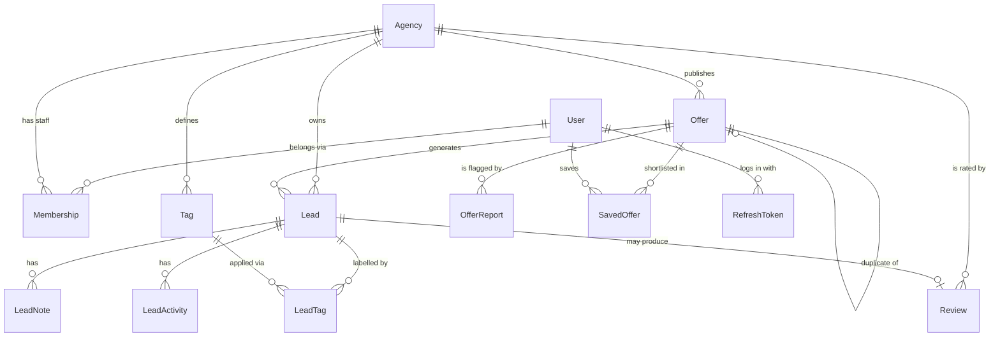

# Data Model Overview

The database is the part hardest to change once real data exists. Code can be rewritten in
a weekend; a wrong table shape follows you for years. So this page is worth understanding
before anything else in the backend.

Source of truth: `apps/api/prisma/schema.prisma`. If this page and that file disagree, the
file is right and this page is a bug — tell me.

---

## The whole map



## The two halves

Everything divides into **public marketplace** and **private tenant space**:

|                | Public side                                                                   | Private side (per agency)                 |
| -------------- | ----------------------------------------------------------------------------- | ----------------------------------------- |
| Who reads it   | anyone, incl. Google                                                          | only that agency's staff                  |
| Tables         | `Agency` (verified only), `Offer` (published only), `Review` (published only) | `Lead`, `LeadNote`, `LeadActivity`, `Tag` |
| Risk if leaked | none, it's marketing                                                          | business-ending — see [[Multi-Tenancy]]   |

Every table on the private side carries a non-null `agencyId`. That column is the entire
security model. See [[Multi-Tenancy]].

---

## The tables, and why each exists

### Identity
- **[[User]]** — one person. A traveler, agency staff, or both. Phone-first or email-first.
- **`RefreshToken`** — stored hashed, rotated, grouped in families so theft is detectable.
  See [[Authentication vs Authorization]].
- **`Membership`** — links a User to an [[Agency]] *with a role*. The role is on the
  relationship, not on the user, so one person can hold different roles at two agencies.

### Supply
- **[[Agency]]** — the tenant. Holds verification state (registre de commerce, tourism
  licence), the rating aggregate, and the plan that sets its limits.
- **[[Offer]]** — one thing for sale. Shared columns for what's filterable, one JSON
  `attributes` column for what's specific to the kind. Read that note; it's the design
  that lets you add features without migrations.
- **`OfferDuplicateCandidate`** / **`OfferReport`** — spam control. Both feed a review
  queue; neither deletes anything. See [[Duplicate and Spam Control]].
- **`SavedOffer`** — a traveler's shortlist. The main reason a traveler makes an account.

### Demand and the CRM
- **[[Lead]]** — a traveler's inquiry. The object you will eventually charge for. Carries
  a contact **snapshot** so it works with no traveler account at all, plus an immutable
  consent trail.
- **`LeadNote`** — free text from staff. Editable.
- **`LeadActivity`** — append-only timeline written by the system. Never edited.
- **`Tag`** / **`LeadTag`** — agency-invented labels, alongside the fixed
  [[Client Quality Labels]].

### Trust
- **`Review`** — an agency rating. Linkable to a completed lead, which is what makes it
  verifiable rather than fiction. See [[Agency Ratings]].
- **[[Audit Log]]** — append-only record of who changed what. Cheap now, impossible to
  reconstruct later.

---

## Conventions used everywhere

**Ids are UUIDv7.** Unguessable, so nobody can walk `/leads/1`, `/leads/2`. Time-ordered,
so the database still indexes them well. Never sequential integers — those leak your
volume and growth rate to anyone who can create two rows a month apart.

**Money is an integer of centimes.** `150 000,00 DZD` is `15000000`. Floats lose money;
`0.1 + 0.2 !== 0.3` in every language with floating point. Column type is `Int`, the API
speaks centimes, only the display layer divides by 100.

**Phones are E.164**: `+213551234567`, always. Normalized during validation so no code path
can store another format. Otherwise you can never match a repeat client.

**Timestamps are UTC**, displayed in Africa/Algiers. `createdAt` and `updatedAt` on
everything — you will want them and can't add them retroactively.

**Deletes are soft.** `deletedAt` instead of removing the row. An agency that deletes a
lead by accident on Thursday wants it back on Friday.

**Enums for fixed lists, tables for open ones.** Lead stages are an enum (you define the
pipeline). Tags are a table (agencies invent their own). Choosing wrong in either direction
is the most common schema mistake — enum means *you* control the values, table means
*they* do.

**Two hot counters are denormalized**: `Agency.ratingSum`/`ratingCount`, and the
moderation counters. Counting reviews on every page load would be slow; a copy is fast but
must be recomputed whenever a review is published or hidden. That's a real cost — accepted
only for values read on every listing page.

---

## Reserved for later, deliberately

Fields that exist now with no code using them, so adding the feature later isn't a
migration of live data:

| Field                                | For                                            |
| ------------------------------------ | ---------------------------------------------- |
| `Agency.plan`                        | premium CRM tiers — [[Plan Limits and Quotas]] |
| `Agency.creditBalanceCentimes`       | prepaid lead credits                           |
| `Agency.publishedOfferLimitOverride` | negotiated partner deals                       |
| `Offer.isFeatured`, `featuredUntil`  | promoted listings (ads)                        |
| `Offer.qualityScore`                 | search ranking                                 |
| `Lead.estimatedValueCentimes`        | lead pricing                                   |

Adding a nullable column to a big table is easy. *Backfilling* one is not, and changing a
column's meaning after code depends on it is worse. Cheap insurance.

---

## Changing the schema

Never edit the database by hand. Edit `schema.prisma`, then:

```bash
npm run db:migrate
```

Prisma writes a migration file, applies it, and regenerates the TypeScript client. The
migration is committed, so the server applies the identical change. See [[Migrations]].

> [!warning] Renaming or dropping a column deletes data
> Prisma will do it without hesitation. Any migration that drops or renames needs a written
> plan first — `CLAUDE.md` rule #7.

---

Related: [[System Overview]] · [[Multi-Tenancy]] · [[Offer]] · [[Lead]] · [[Migrations]] ·
[[Indexes and Why Queries Get Slow]]
