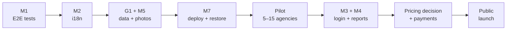

# Roadmap

> [!info] What this note is
> The delivery map: **which phase Rihlati is in, what gates the next one, and what would
> make us stop.** Written 2026-10-28.
>
> Three notes overlap on purpose, and each answers a different question:
> - [[Vision and Roadmap]] — *what the product is and who pays for it.*
> - **This page** — *in what order it reaches real people, and what must be true before each
>   step.*
> - [[Milestone Plan]] — *the engineering detail and the definition of "done" for each item.*
>
> This page never redefines a milestone. It takes the existing M1–M7 and the Known Gaps, and
> says which phase each one gates.

> [!note] Three assumptions behind the phases
> 1. **The pilot is hand-picked:** 5–15 agencies in Alger and Oran, accounts created by us,
>    offers built from the Facebook posts they already publish ([[Decisions You Must Make]] §1).
> 2. **The pilot takes no money.** Payments land in Phase 2, which is why Phase 2 is called
>    *public launch* and not *scale*.
> 3. **No calendar dates.** Sequence and gates only. A date invented today is a promise the
>    code cannot keep, and this page is supposed to stay true.
>
> Change any one of these and the phases move; the dates, the payments and the pilot's size
> are the three knobs the rest of this page is arranged around.

---

## 🗺️ The map

![[roadmap.svg|900]]

*Pins are milestones; the ledger further down is the text version and stays authoritative.
A static map is updated by hand — when a milestone moves, move its pin and its card.*

**In the app:** `GET /roadmap/` renders the same map from `apps/pages/roadmap.py` — a
responsive HTML road rather than this image, so the cards stay readable on a phone. Same
stops, same order, same statuses; the footer links to it.

**Read it top to bottom.** Each band's gate is not a date; it is the sentence under the band
title. Nothing in a later band starts because the previous one ran out of tasks — it starts
because its gate is true.

### Critical path — the chain that cannot be parallelised

Everything else — the CRM redesign, reviews UI, image polish, the chat — can move around
this chain. These seven cannot. If one slips, the launch slips by its length, because each
is the input to the next: you cannot pilot on real photos when the database still accepts
arbitrary JSON, and you cannot launch publicly when there is no way to take a dinar.

---

## 🟢 Phase 0 · Preview — where we are

Built, tested and reachable from a browser: the marketplace, the agency console, the trip
manifest and bus check-in, tracked links, offer analytics, the verification queue, the
audit log, and reviews on the backend. [[Milestone Plan]] has the full table.

Also built, and deliberately **not** counted as a milestone: the [[Agency Chatbot]] v1 — a
read-only assistant on each published offer, with agency-owned instructions and a
manager-only editor. It is a preview to measure, not a feature to rely on.

What the preview does **not** prove:

- that a page renders correctly in a real browser (nothing does — see M1);
- that an Arabic-speaking traveler can read any of it (M2);
- that an agency can add its own photographs (M5);
- that any of it survives a deploy, a restart, or a restored backup (M7).

`Decisions You Must Make` §8 still says v1 has "no AI chatbot." The code has had one since
[[Decision Log]] 031, and an editable one since 032; where that note and this one disagree,
the code wins.

---

## 🔵 Phase 1 · Pilot-ready

**Gate:** 5–15 hand-picked agencies, real travelers, real phone numbers. No payments.

The pilot's job is not to earn. It is to find out whether the loop actually spins: a traveler
finds a verified offer, sends an inquiry, and a named person at the agency answers it.

### Engineering gates

| Item | Why it blocks the pilot | Done means |
|---|---|---|
| **M1 · End-to-end tests** | Every remaining item changes a page. Without this, the first pilot bug is also the first warning. | The five rule-7 pages driven in a real browser, screenshot assertions, inside `./scripts/check.sh`. |
| **M2 · Interface translation** | Arabic is not reachable today, and retrofitting RTL after the screens exist costs more. | `LocaleMiddleware`, `gettext` on every string, `locale/ar` + `locale/fr` compiled, a switch, and a build check against bare French literals. |
| **G1 · `attributes` schema** | The only gap that gets worse while you wait, and the pilot is when real rows get written. | Per-kind schema called from **both** `OfferIn` and `OfferForm`; unknown keys rejected. |
| **M5 · Image uploads** | Pilot agencies will supply their own photos. A hotlinked URL is a fixture, not a listing. | Validated type and size, EXIF stripped, files served outside the app process. |
| **M7 · Deploy + restore** | `runserver` is not a pilot environment, and there is no backup until one has been restored. | `gunicorn`/`Dockerfile`, `STATIC_ROOT`, the six `SECURE_*` warnings silenced honestly, [[Restore From Backup]] rehearsed into a scratch DB with the date written down. |

### Operational gates — not code, and not optional

| Item | Why | Done means |
|---|---|---|
| **P1-O1 · Onboarding runbook** | Forty agencies recruited by hand is the strategy; improvising it per agency is how the third one gets a duplicate listing. | A checklist: documents collected, verification decision, offer photos, programme, first test inquiry, who answers the phone. |
| **P1-O2 · Legal basics** | The pilot stores real names and phone numbers under Law 18-07. | Terms of service, a privacy policy that matches what the database actually stores, and a lawyer's answer on the consent model — before the first traveler number arrives. |
| **P1-O3 · Measurement** | The pilot exists to produce evidence, not reassurance. | A weekly sheet: inquiries per agency, response time, leads that became reservations, chat questions answered vs "je ne sais pas", and the top three reasons an agency ignored a lead. |
| **P1-O4 · Support channel** | A pilot agency with a broken login must have somewhere to go that is not your personal WhatsApp. | One named channel, one response-time promise, one incident runbook. |

### Phase 1 exit gate

All of these, at once:

- 5–15 verified agencies, each with at least one published offer built from their own material;
- at least four weeks of real inquiries, with a human answering inside the promised window;
- a restore from backup performed on the real pilot database, not a demo one;
- the chat measured for two consecutive weeks, with a decision recorded about whether it
  stays on (see [[Decision Log]] 031's open question);
- every issue found during the pilot either fixed or written into [[Known Gaps]] with a date.

**If the pilot fails,** it fails here, cheaply, with five agencies and no money owed. That is
the point of putting it before payments.

---

## 🟠 Phase 2 · Public launch

**Gate:** open traffic, and at least one agency that has paid.

Phase 2 is where the product stops being a demo with real users and becomes a business. Most
of its work waits on your decisions: the engineering items are blue on the map, the
decision-bound ones amber.

### Engineering

| Item | Why it is here and not earlier | Done means |
|---|---|---|
| **M3 · Phone/email login** | Pilot accounts are handed over by us; public agencies are not. | One `identifier` field, E.164 or email, normalised; identical error text for unknown account and wrong password. |
| **M4 · Report review queue** | Reports already increment counters that nothing reads. Once the public can report, that becomes a lie. | Staff-only queue, decision recorded in the [[Audit Log]], counters decremented on resolution, `dismissed` status exists. |
| **M6 · CRM redesign** | It reshapes screens, which M1 exists to protect. It is value, not a gate — do it during the pilot, not before it. | The build order in [[CRM Redesign]], ending with the "Rappeler quand ?" prompt. |
| **Reviews UI** | The backend is done and unused. Cheap, visible trust. | A traveler can leave a review from a real lead, an agency can reply, both sides render. |
| **G4 + self-signup** | Conditional: if agencies still sign up by hand at launch, this moves to Growth and G4 stays a ten-line fix. | A second agency can be created through the product without hitting the empty-slug constraint. |
| **G5 · single-offer read** | Small API gap surfaced by the isolation tests; fold it into the M6 work. | `GET` one offer, with the create-as-A / fetch-as-B / assert-404 test. |

### Money and operations

| Item | Why | Done means |
|---|---|---|
| **P2-M1 · Billing model** | Prepaid credits, subscription or per-lead — [[Decisions You Must Make]] §5. Nothing else about money can be designed first. | One written answer, with DZD prices. |
| **P2-M2 · Credits + plan gate** | The plan table is decorative while every feature is open to every plan. | `has_feature(agency, …)` in `apps/common/quotas.py`, the gates applied, a manual CCP/BaridiMob confirmation that loads a balance. |
| **P2-O1 · Cron** | Three things already need it: `purge_chat`, the rating reconcile (G3), and expiry jobs. | A scheduler that survives a deploy, with one alert when a job does not run. |
| **P2-O2 · Shared cache** | G6: the login limit counts in local memory and multiplies by worker count. | Redis or a database cache before more than one worker runs. |
| **P2-O3 · Monitoring** | You cannot run a marketplace on "the agency will tell us." | Uptime, error rate, and one alert that reaches a human. |

### Phase 2 exit gate

- a paying agency, with an invoice and a balance that reconciles by hand;
- 30 days without an unplanned outage, and a second restore rehearsal on the production
  database;
- G1, G3 and G6 closed — no defect on [[Known Gaps]] that accumulates damage;
- the plan table enforcing something, or an explicit decision that it will not.

---

## 🟣 Phase 3 · Growth — pointer only

Not planned in detail here, because planning it now would be fiction. The shape, from
[[Vision and Roadmap]]:

- **Promoted listings and credits spend** — designed in [[Credits and Promotion]], fields
  already in the schema.
- **WhatsApp Business API** — same bot, different transport; `wa.me` links come free today.
- **Mobile app** — the API is already the hard part.
- **Chat v2** — tools (`create_reservation`, `handoff`), the FAQ mining queue, and the
  hosted-model decision that [[Agency Chatbot]] says to make before real travelers rely on it.
- **Cross-agency reputation** — lawyer first; this is the line between a CRM and trading in
  personal data.
- **Retire one of the two vaults.** Two repositories describing one product is how both
  become wrong; [[Milestone Plan]]'s open question is still open.

---

## 📋 Milestone ledger

One row per item that can be checked off. Status: ✅ built · 🔜 next · 🟡 in pilot · ⛔ blocked
on a decision · ⬜ later.

| ID | Milestone | Phase | Status | Depends on | Exit criterion | Detail |
|---|---|---|---|---|---|---|
| P0-1 | 🏪 Marketplace, console, auth, API | 0 | ✅ | — | Reachable from a browser, suite green | [[Milestone Plan]] |
| P0-2 | 🚌 Manifest, tracked links, analytics, reviews backend | 0 | ✅ | P0-1 | Same | [[Milestone Plan]] |
| P0-3 | 🤖 Chat v1 | 0 | ✅ | P0-1 | Public route, widget, editor, full page | [[Agency Chatbot]] |
| M1 | 🧪 End-to-end tests | 1 | 🔜 | — | Five pages driven in a browser, in `check.sh` | [[Milestone Plan]] |
| M2 | 🌍 Interface translation | 1 | 🔜 | M1 | AR + FR compiled, switch works, build rejects bare literals | [[Milestone Plan]] · [[Decisions You Must Make]] §7 |
| G1 | 🧱 `attributes` schema | 1 | 🔜 | — | Both entry points reject unknown keys | [[Known Gaps]] · [[Offer]] |
| M5 | 📸 Image uploads | 1 | 🔜 | — | Validated, stripped, served off-process | [[Image Uploads]] |
| M7 | 🚀 Deploy + restore | 1 | 🔜 | M1, M2, G1, M5 | Production start path + rehearsed restore | [[Milestone Plan]] · [[Restore From Backup]] |
| P1-O1 | 🤝 Onboarding runbook | 1 | ⬜ | — | Checklist exists and one agency completed it | [[Agency Verification]] |
| P1-O2 | ⚖️ Legal basics | 1 | ⛔ | Lawyer | Terms + privacy + consent model signed off | [[Decisions You Must Make]] §3 |
| P1-O3 | 📊 Pilot measurement | 1 | ⬜ | M7 | Four weeks of numbers, written down | — |
| P1-O4 | 🎧 Support channel | 1 | ⬜ | — | Named channel + response promise | — |
| M3 | 🔐 Phone/email login | 2 | 🔜 | Pilot | One identifier field, identical error text | [[Accounts]] |
| M4 | 🚩 Report queue | 2 | 🔜 | — | Staff queue, audit row, counters decrease | [[Duplicate and Spam Control]] |
| M6 | 📋 CRM redesign | 2 | 🔜 | M1 | Build order complete, callback prompt works | [[CRM Redesign]] |
| RV | ⭐ Reviews UI | 2 | 🔜 | — | Review from a real lead renders both ways | [[Agency Ratings]] |
| G4 | 🪪 Agency slug + signup | 2 | ⛔ | Decisions §1 | Second agency created in-product | [[Known Gaps]] · [[Agency]] |
| G5 | 🔎 Single-offer read | 2 | 🔜 | — | Route + isolation test | [[Known Gaps]] |
| P2-M1 | 💳 Billing model | 2 | ⛔ | Your call | One written answer with prices | [[Decisions You Must Make]] §5 |
| P2-M2 | 🪙 Credits + plan gate | 2 | ⛔ | P2-M1 | Balance loads manually, features gated | [[Credits and Promotion]] · [[Plan Limits and Quotas]] |
| P2-O1 | ⏰ Cron | 2 | 🔜 | M7 | Scheduler with an alert on missed jobs | [[Architecture]] |
| P2-O2 | 🧠 Shared cache (G6) | 2 | 🔜 | M7 | Login limit correct with N workers | [[Known Gaps]] |
| P2-O3 | 📈 Monitoring | 2 | ⬜ | M7 | Errors and downtime reach a human | — |
| P3-* | 🌱 Growth | 3 | ⬜ | Phase 2 exit | — | [[Vision and Roadmap]] |

---

## 🧭 Decision gates — the things only you can answer

Each one blocks a whole column of the ledger above. They are collected in
[[Decisions You Must Make]]; this is the order the roadmap needs them in.

| When | Decision | Blocks |
|---|---|---|
| Before the pilot starts | **Verification sentence** — what "Verified" means, in one sentence that is true | P1-O1, the badge itself |
| Before the first traveler phone number | **Consent model**, reviewed by a lawyer | P1-O2 |
| Before Phase 2 | **Billing model** — prepaid credits, subscription or per-lead | P2-M1, P2-M2 |
| Before Phase 2 | **DZD prices**, and what Business adds | P2-M2 |
| Before launch | **Self-signup, or by hand for the first forty** | G4, Phase 2 scope |
| Before launch | **Default language** — Arabic or French | M2's final switch |
| Before launch | **Contact reveal** — immediate, or after the agency responds | Lead economics, billing |
| Before chat v2 | **Local model or hosted**, measured against real pilot questions | Phase 3 |

---

## ⚠️ Risks

| Risk | Early warning | Response |
|---|---|---|
| **G1 rots the offer data** | Unknown attribute keys appear in real rows; two agencies describe the same fact differently | Fix before the pilot writes rows; a cleanup script is more expensive than the schema. |
| **Pilot agencies ignore leads** | Response time rises week over week; "no answer" becomes the top pilot complaint | The product is not the bottleneck — recruiting is. Slow down and fix the human loop before adding agencies. |
| **The 14B model answers wrong** | "Je ne sais pas" rate too low *and* spot-checks show invented facts | Turn the widget off for the pilot; the inquiry form still works. Decide about a hosted model before Phase 3. |
| **Deploy without a restore** | The rehearsal keeps being "next week" | M7 is not done until the date is written down. Rule 5: until then there is no backup, only hope. |
| **Legal surprise** | Privacy policy describes data the database does not actually store, or vice versa | Lawyer before the first real phone number, not before launch. |
| **The badge promises more than we can check** | An agency passes verification and defrauds a traveler | Weaken the claim until it is true; see [[Agency Verification]]. |

## 🛑 What would make us stop

Written down now, while it is cheap to be honest. Any one of these is a reason to pause the
roadmap, not to push through it:

- four weeks of pilot inquiries and **no agency answers a lead** within the promised window —
  the wedge is wrong, or the onboarding is;
- the lawyer says the consented-introduction model needs a redesign — the business model is
  the product here, and code cannot rescue it;
- **no agency will pay** after a month of real leads — then the pricing, not the feature
  list, is the problem;
- spot-checking the assistant finds invented prices or inclusions **after** the prompt has
  been tightened once — the feature is not safe to expose.

---

## 🧰 How to use this page

1. **A milestone is checked only when its exit criterion is true**, not when the code is
   written. The criterion is in [[Milestone Plan]]; this page only points at it.
2. **Update the status cell, the pin and the app data**, not the prose. The prose is the
   argument; the table and the map are the state. A pin is a coloured dot on the card and a
   number on the road — moving one without the other is how a map starts lying. The app has a
   third copy in `apps/pages/roadmap.py` because a static SVG cannot reflow on a phone; when a
   status changes, that tuple is part of the edit.
3. **When a gate passes, write it in [[Decision Log]]** with the date and what was actually
   measured. A roadmap that only moves forward is not being used.
4. **When reality changes a phase**, change the phase and say why in one line. A stale
   roadmap is worse than no roadmap, because people plan against it.

Related: [[Vision and Roadmap]] · [[Milestone Plan]] · [[Known Gaps]] ·
[[Decisions You Must Make]] · [[Decision Log]] · [[The Seven Rules]] · [[Architecture]]
